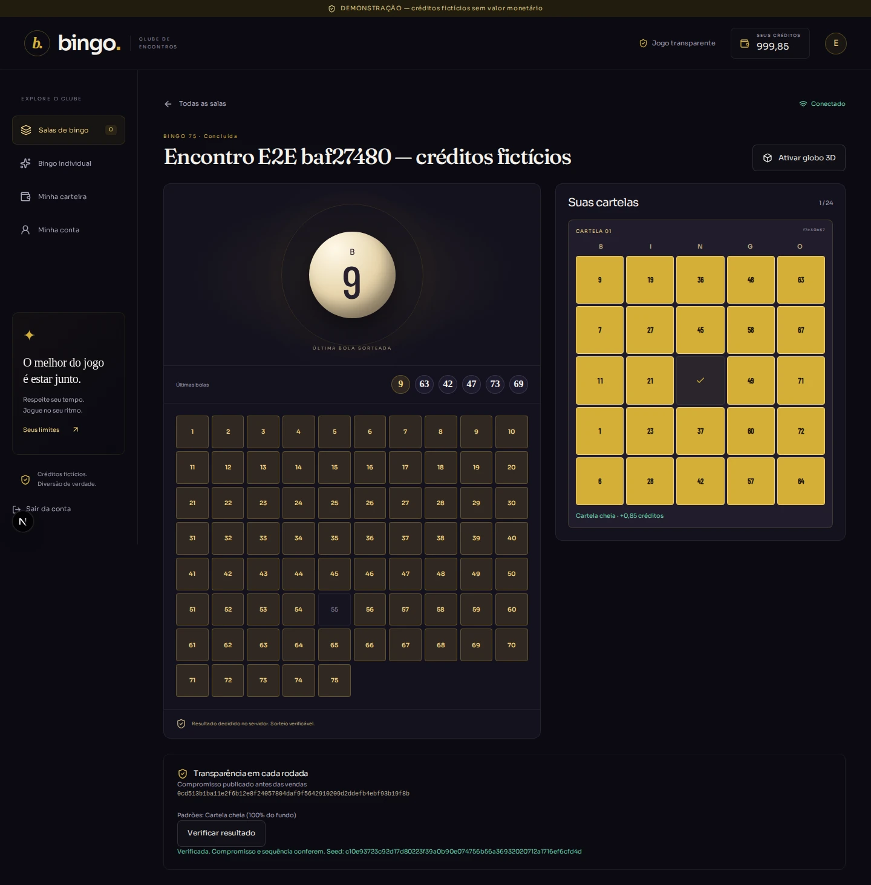

# Bingo — demonstração multiplayer e individual

Bingo 75, 80 e 90 bolas com servidor autoritativo, carteira contábil e verificação de sorteios. **Somente créditos fictícios sem valor monetário, resgate ou conversão.**

## Executar localmente

Pré-requisitos: Node.js 24, pnpm 11.25 e Docker Compose v2.

```sh
./scripts/dev.sh
```

O script preserva `.env` existente ou gera uma chave criptográfica local, constrói os serviços, aplica migrações e inicia:

| Serviço                    | Endereço local                     |
| -------------------------- | ---------------------------------- |
| Jogador                    | http://localhost:3000              |
| Administração              | http://localhost:3001              |
| API / saúde                | http://localhost:4000/health       |
| OpenAPI                    | http://localhost:4000/openapi.json |
| E-mails de desenvolvimento | http://localhost:8025              |

PostgreSQL e Redis persistem em volumes e não expõem portas no host. API/worker usam um papel SQL separado do proprietário das migrações. As senhas do Compose e o bypass Turnstile são exclusivos do ambiente local; este Compose não é uma configuração de hospedagem pública.

## Primeiro acesso

1. Crie uma conta no site, com senha de pelo menos 12 caracteres.
2. Abra o e-mail de confirmação no Mailpit. Ao confirmar, a carteira recebe **1.000 créditos fictícios**, uma única vez.
3. Entre com a conta. Para criar salas, promova explicitamente uma conta verificada:

```sh
docker compose exec api pnpm --filter @bingo/api exec node --import tsx src/promote-admin.ts seu-email@example.com
```

4. No painel administrativo, configure o autenticador TOTP e confirme o código. O acesso administrativo exige MFA ativo; não existe senha de admin padrão.
5. Crie uma sala no admin, depois compre cartelas no site do jogador. O worker fecha as vendas, sorteia e paga automaticamente. Para testar multiplayer, utilize duas contas em perfis de navegador diferentes.
6. Após concluir uma rodada, use **Verificar resultado**. No individual, prepare o compromisso antes de confirmar a participação; a liquidação antecede a animação.

Reiniciar API/worker não deve apagar compras ou sorteios: os dados e a cadência estão no PostgreSQL. Não use `docker compose down -v` se quiser preservar os dados.

## Banco no Supabase

O projeto dedicado `bingo` já possui o schema privado com 34 tabelas e RLS. Configure `DATABASE_SCHEMA=bingo` no servidor ao usar esse banco; o Compose local continua usando `public`. A API e o worker ainda precisam de implantação e credencial privada de execução. [Configuração, verificações e limites](docs/supabase.md).

## Comandos de verificação

```sh
pnpm install --frozen-lockfile
pnpm format:check
pnpm lint
pnpm typecheck
pnpm test:coverage
pnpm test:integration
pnpm build
pnpm exec playwright install chromium
pnpm test:e2e
pnpm --filter @bingo/api exec node --import tsx ../../scripts/simulate.ts
```

Integração usa Testcontainers com PostgreSQL 16 real e requer Docker, ou `TEST_DATABASE_URL` apontando para um banco descartável vazio. O teste de recuperação inicia e mata um processo real. Nunca direcione testes a um banco de usuários reais. O CI sobe o Compose completo, verifica API/web/admin e restaura um backup em banco separado. Também habilita o fluxo de jogo pelo navegador contra PostgreSQL/API reais; localmente, esse teste requer E2E_DATABASE_URL e a stack iniciada. O smoke visual isolado não substitui esse fluxo.

## Implementado e limites atuais

- Monorepo pnpm/Turbo, TypeScript estrito, Next.js jogador/admin, Fastify, Drizzle/SQL, PostgreSQL, Redis/outbox, Mailpit, Compose e CI.
- Cadastro, confirmação, recuperação, sessões revogáveis por API, TOTP e proteção de operações por origem/CSRF. Turnstile obrigatório em modo production.
- Créditos inteiros, razão balanceado no COMMIT, lançamentos imutáveis, idempotência, reconciliação e compras transacionais.
- Cartelas e padrões 75/80/90, prêmios proporcionais e fixos com reserva integral, 90 com linha/duas linhas/cheia, rateio determinístico e recuperação persistente do sorteio.
- Bingo individual com cálculo conjunto exato por inclusão-exclusão e tabela versionada; relatório de **1 milhão de simulações** em [instant-math.json](docs/reports/instant-math.json).
- Lobby sem contadores inventados, sala 2D, globo Three.js opcional, carteira, limites/pausa/exclusão, painel com dupla aprovação financeira e verificador independente com WebCrypto.
- Máquina de estados completa com trilha de transições e snapshots; versões imutáveis, agendamento/recorrência, cancelamento/estorno, papéis financeiros e suporte.
- Histórico, atendimento privado, download dos próprios dados, notificações por API e desativação pseudonimizada. [Operação e retenção](docs/operations.md).

**Ainda não equivale à entrega integral do briefing.** Faltam, entre outros, interfaces completas para todos os controles administrativos e privacidade, revisão da retenção de dados, filas BullMQ, fan-out Redis consumido pelo gateway (o WS atual usa replay durável por consulta), cenas/áudio avançados, perfis automáticos de qualidade, PWA, carga progressiva, certificação/revisões independentes, observabilidade completa e implantação pública. Nenhuma capacidade de 10.000 jogadores foi medida ou prometida.

## Documentação e evidências

[Briefing](PROJECT_BRIEF.md) · [Arquitetura proposta](docs/ARCHITECTURE.md) · [Roadmap](docs/ROADMAP.md) · [Riscos](docs/RISKS.md) · [Decisões](docs/adr/README.md) · [Relatório de implementação](docs/reports/implementation-2026-10-16.md)

[**CI verificado: 50 testes passaram**](https://github.com/betwenes-ops/bingo/actions/runs/38920267692): 24 locais, 20 de integração em PostgreSQL real e 6 de navegador, incluindo o fluxo completo em desktop/celular. Build, lint, typecheck, auditoria, Compose completo e restauração estrutural de backup também passaram.

O relatório distingue testes executados, testes apenas configurados e gates ainda abertos. Não há deploy público nesta entrega.

## Capturas reais dos testes




[Mobile — sala](docs/screenshots/game-completed-mobile.webp) · [Mobile — individual](docs/screenshots/instant-result-mobile.webp) · [Desktop — individual](docs/screenshots/instant-result-desktop.webp)

Amostras com usuários/salas de teste explicitamente identificados. [Estado por fase](docs/STATUS.md) · [Protocolo de verificação](docs/rng-protocol.md) · [Ativos e licenças](docs/asset-needs.md)
