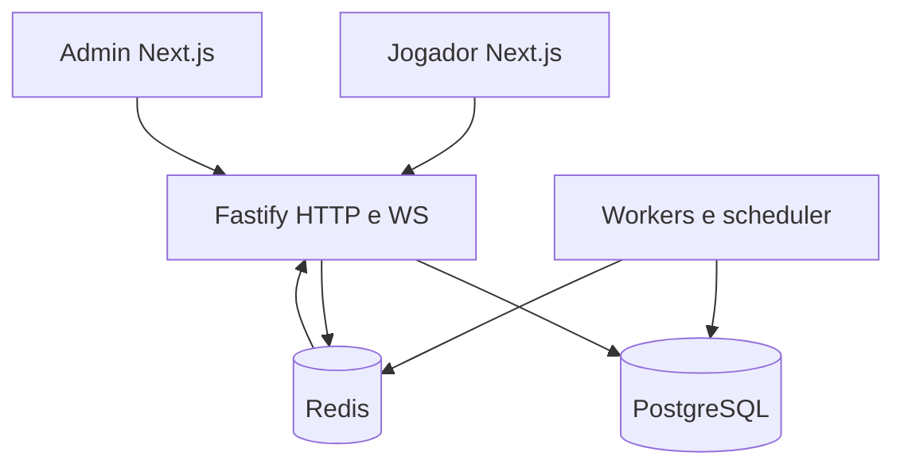

# Arquitetura proposta

Status: proposta para aprovação, 2026-10-16. Fonte normativa: PROJECT_BRIEF.md. Nome provisório interno: Bingo; marca e domínio não definidos.

## Escopo e implantação

Dois motores independentes, multiplayer 75/90/80 e Instant Bingo 75, compartilham identidade, carteira, catálogo e auditoria. Apenas créditos fictícios. Aviso fixo em todas as telas: “DEMONSTRAÇÃO — créditos fictícios sem valor monetário”. Nenhum adaptador monetário será instalado ou habilitado nesta entrega.

Monólito modular TypeScript: apps/web e apps/admin em Next.js; apps/api em Fastify, com modos de processo HTTP/WS e worker no mesmo código. PostgreSQL 16+ é fonte de verdade; Redis fornece presença, pub/sub e BullMQ. Serviços persistentes em contêineres, sem motor em funções stateless. Seleção de nuvem depende de aprovação de custo antes de provisionar.

Estrutura: apps/{web,admin,api}; packages/{domain,bingo-math,protocol,ui,scene3d,config}; infra; docs. Domínio puro recebe bytes aleatórios por interface determinística, sem I/O; o adaptador RNG usa crypto no backend. Cliente nunca recebe seeds ou sequência futura antes do encerramento.

## Fronteiras e contratos internos

| Módulo        | Responsabilidade e interface pública prevista                                                                                                      |
| ------------- | -------------------------------------------------------------------------------------------------------------------------------------------------- |
| identity      | register, verifyEmail, authenticate, rotateSession, revokeSession, requireMfa; Argon2id, cookies seguros, tokens de uso único armazenados por hash |
| wallet        | postBalancedTransaction, reserve, release, reconcile; exige contexto transacional e chave idempotente                                              |
| catalog       | publishVersion, getPublishedRules; versões publicadas imutáveis                                                                                    |
| rng           | commit, deriveSequence, reveal, verify; algoritmo e serialização versionados                                                                       |
| cards         | generateCard, validateCard, evaluatePatterns por modalidade                                                                                        |
| prizes        | allocatePool, splitTies, evaluateAwards; inteiros e resto determinístico                                                                           |
| rooms         | purchaseCards, closeSales, advanceRound, cancelBeforeDraw; máquina de estados persistida                                                           |
| instant       | playAndSettle; débito, resultado e crédito na mesma transação                                                                                      |
| realtime      | authorizeSubscription, replay, snapshot; cursor por partida                                                                                        |
| admin         | comandos autorizados, motivo, dupla aprovação; sem editar resultados                                                                               |
| audit         | appendAudit; apenas inserção com ator e correlação                                                                                                 |
| compliance    | checkParticipation, pause, selfExclude; verificado em cada compra                                                                                  |
| payments      | interface e adaptador indisponível; qualquer chamada retorna operação desativada                                                                   |
| notifications | entrega in-app e e-mail por eventos idempotentes                                                                                                   |

Módulos só importam interfaces públicas, verificados por lint de fronteiras. A unidade de trabalho PostgreSQL pertence à camada de aplicação para compor carteira, compra e outbox atomicamente, sem cada serviço abrir transações independentes.

## Persistência e invariantes

Drizzle com SQL revisável para constraints, locks e triggers. Tabelas mínimas e nomes são os da seção 16 do briefing. Acrescentar email_verification_tokens, password_reset_tokens, mfa_credentials, admin_adjustment_requests e support_cases. ER e justificativa de índices serão entregues com migrações, antes do gate da Fase 1.

Valores BIGINT em centésimos de crédito; JSON transporta strings decimais, nunca Number. Débitos/créditos representados por amount positivo e direção, com soma assinada zero por transação. CHECK de uma linha não valida soma entre linhas: usar constraint trigger diferida no COMMIT, mínimo de dois lançamentos e status de posting restrito. Papel da aplicação sem UPDATE/DELETE no razão, auditoria ou eventos; correções apenas compensatórias. Cache wallet disponível/reservado atualizado junto ao razão e reconciliado periodicamente.

Chaves únicas: usuário+operação+idempotency_key; prêmio por round+card+pattern; bola por round+position e round+number; evento por round+seq e eventId; compra por purchaseId. Repetição com payload diferente retorna 409. Resultado original e hash do pedido são armazenados na mesma transação. Chaves financeiras não expiram enquanto houver obrigação de replay.

## Compra e fechamento concorrentes

Ordem global de locks: partida, carteiras/contas por ID crescente, fundos e demais linhas. Compra trava a partida e verifica OPEN_FOR_SALES, prazo pelo relógio do banco, limites, exclusão e saldo. Trava carteira; grava compra, cartelas, razão, cache, auditoria e outbox em uma única transação. Fechamento usa a mesma trava; não existe janela entre validar e congelar. Deadlocks/serialização recebem retry limitado com a mesma chave.

OPEN_FOR_SALES congela regras, taxa de fundo, padrões, mínimo, cadência e política de cancelamento. SALES_CLOSED congela manifesto ordenado das cartelas. round_id é identidade estável criada antes das vendas; manifesto entra separadamente no contexto criptográfico, evitando redefinir PK/FKs no fechamento.

## Sorteio e liquidação

Estados: CREATED → SCHEDULED → OPEN_FOR_SALES → SALES_CLOSED → READY → DRAWING → VERIFYING → SETTLING → COMPLETED. CANCELLED apenas antes da primeira bola conforme regra publicada; FAILED preserva obrigações e exige recuperação auditável, nunca apaga prêmio pendente. Incidente durante DRAWING pausa avanço e retoma a sequência original.

Scheduler consulta next_ball_at e adquire pg_advisory_xact_lock por round dentro da mesma transação que trava a linha, valida estado/posição, grava bola, avalia todos os vencedores simultâneos, eventos e outbox. Nenhuma publicação antes do COMMIT. Uma posição já gravada não avança novamente. Ao atrasar, retoma a cadência sem disparar todas as bolas atrasadas juntas. Workers concorrentes usam a mesma disciplina de locks; Redis não decide o dono nem o resultado.

Prêmios e parcelas são decididos e congelados por regra. Crédito de cada vencedor e marca de liquidação são atômicos e idempotentes; COMPLETED somente após todos os pagamentos confirmados. Fundos são contas segregadas. Prêmio fixo exige reserva garantidora antes das vendas; cancelamento libera reservas e reembolsa com compensações únicas. Nenhum prêmio excede o fundo reservado.

## RNG e verificação

Seed de 32 bytes do SO, commitment publicado antes das vendas, seed cifrada por AES-GCM com chave fora do banco e versão para rotação. HMAC-SHA256 com separação de domínio entre geração de cartela e sorteio; contador e rejection sampling alimentam Fisher-Yates. Definir formato binário/canônico e vetores dourados antes de implementar; nada depende de ordenação incidental de JSON.

Contexto público inclui algorithmVersion, roundId, gameVersion, manifesto SHA256, nonce e clientSeed quando aplicável. Manifesto público usa IDs pseudônimos e cartelas, sem identidade pessoal. Seed revelada após liquidação permite reconstrução independente. Commit-reveal prova consistência posterior; não elimina conhecimento antecipado do operador ou aborto seletivo. Entropia externa independente é evolução documentada no ADR 0003.

No instantâneo, commitment de uso único é entregue antes da confirmação; a compra consome esse compromisso com clientSeed e nonce. Geração, 30 bolas, avaliação do padrão de maior pagamento e liquidação são atômicas antes da animação. Tabela ilustrativa não será publicada sem relatório exato e simulação.

## API e tempo real

Prefixo /v1, Zod e OpenAPI derivados dos mesmos schemas. Rotas previstas: /auth/{register,verify-email,login,logout,forgot-password,reset-password,mfa}, /me, /me/sessions, /wallet, /wallet/entries, /rooms, /rounds/:id, /rounds/:id/purchases, /rounds/:id/events?afterSeq, /rounds/:id/proof, /instant/games, /instant/plays e /admin/*. Mutações financeiras exigem Idempotency-Key. Erros incluem code, correlationId e detalhes seguros; cursor para paginação.

WS /v1/realtime usa cookie de sessão e Origin permitido; sem token em URL. Envelope: {v:1,eventId,roundId,seq,type,ts,payload}. Eventos mínimos da seção 13; WALLET_UPDATED vai a canal privado com cursor próprio, nunca ao fluxo público da sala. Heartbeats, tamanho/frequência limitados, backpressure, deduplicação e detecção de lacunas. Snapshot contém snapshotSeq, regras, bolas já reveladas e cartelas autorizadas; replay começa em snapshotSeq+1. Handshake de recuperação fecha a corrida entre snapshot e inscrição. Redis pode perder mensagens: banco/eventos são a recuperação durável. Outbox entrega pelo menos uma vez; consumidores deduplicam.

## Segurança, experiência e operação

Admin em origem separada, RBAC em cada comando e MFA obrigatório. CSRF em mutações por cookie, CSP/CORS restritos, proteção IDOR, rate limit, Turnstile validado no servidor; bypass apenas dev/test. Dupla aprovação e limites aplicam-se antes da mutação. Rotas monetárias ausentes e boot rejeita flag monetária ativa.

UI pt-BR, i18n, fuso America/Sao_Paulo, mobile 360–430 px, alvos 44 px, estados completos, teclado, contraste AA e reduced-motion. Three.js procedural lazy com fallback funcional 2D; animação nunca determina resultados. Paleta e fontes da seção 19; inventário de licenças antes de incorporar arquivos externos.

Pino sem PII/seeds, correlationId até WS; OpenTelemetry e Prometheus para locks, scheduler, outbox, reconexão, lag e conciliação. Backups com restauração em ambiente isolado. local/staging/production-demo separados. CI e capacidade são objetivos ainda não medidos; relatórios devem conter saídas reais e nenhuma capacidade presumida.
